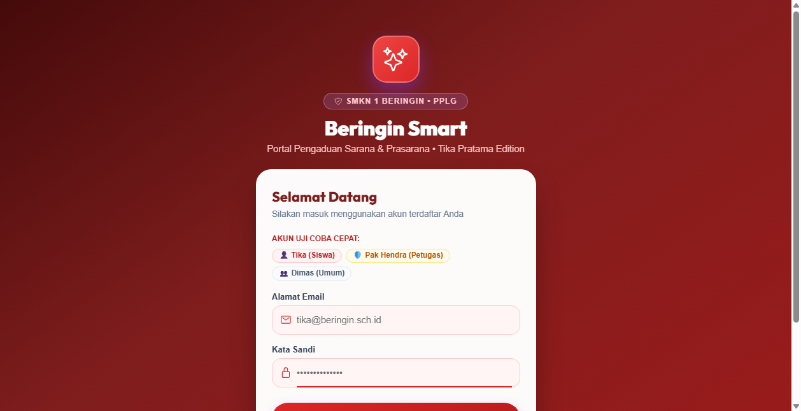
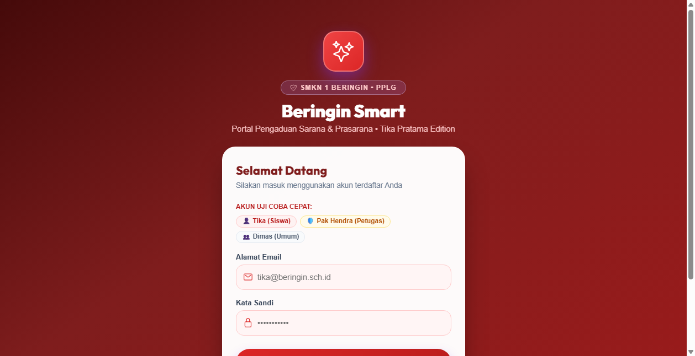
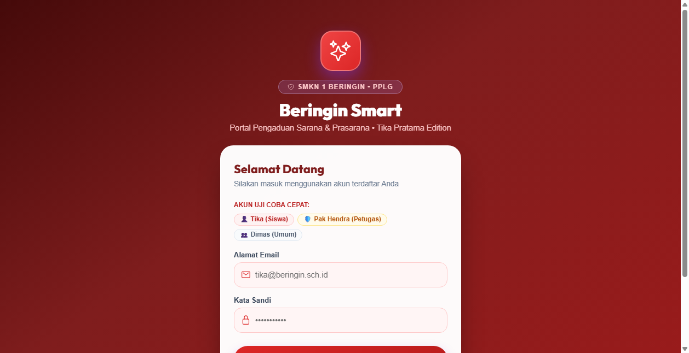
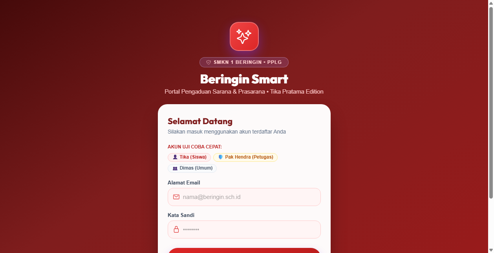
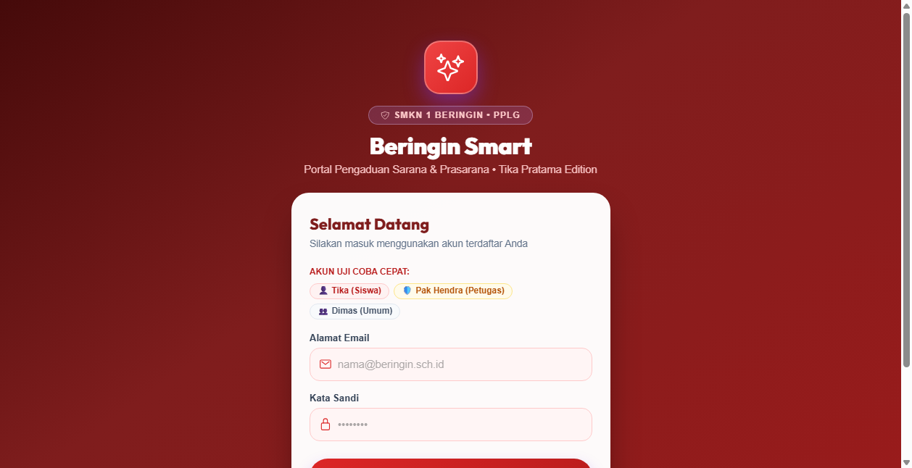
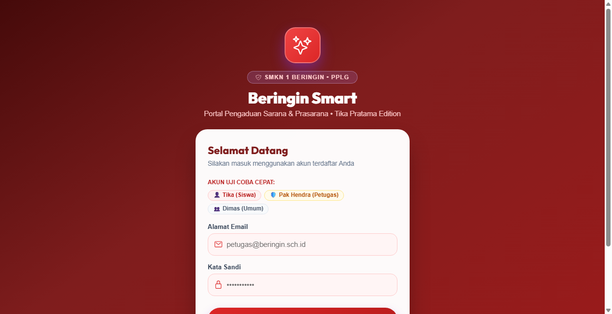
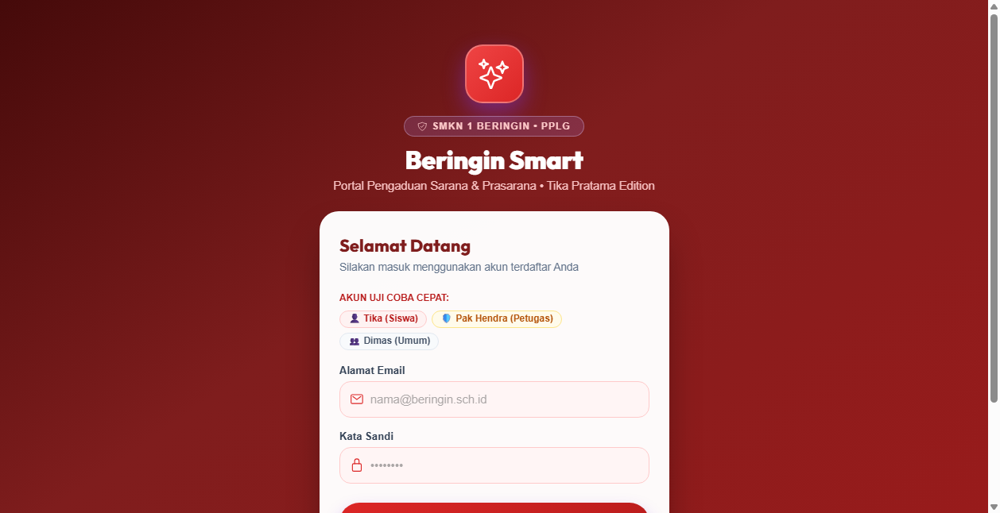
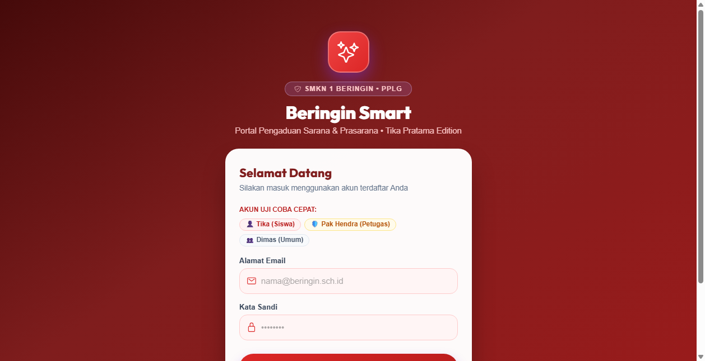
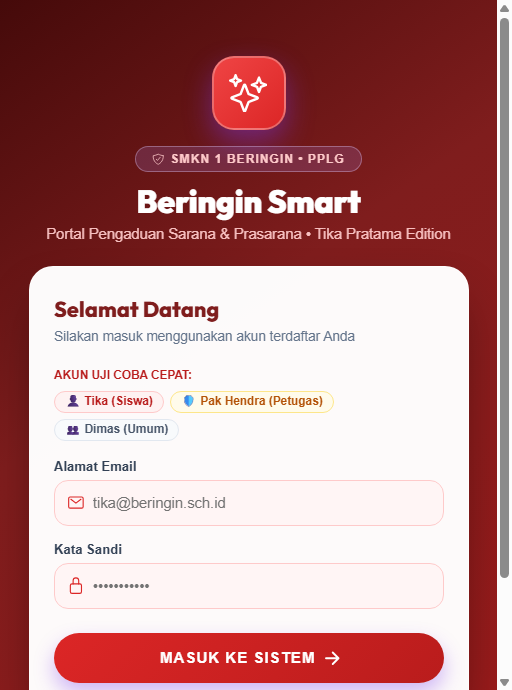

# Beringin Smart — Portal Pengaduan Sarana & Prasarana Sekolah
> **Edisi Khusus: Tika Pratama (XI PPLG 1)**  
> **SMK Negeri 1 Beringin • Tahun Ajaran 2026/2027**  
> Standar Kompetensi Kerja Nasional Indonesia (SKKNI) No. 282 Tahun 2016  
> Tema Identitas Antarmuka: **Crimson Ruby & Deep Burgundy**

---

## 📌 Deskripsi Proyek
**Beringin Smart (Tika Pratama Edition)** adalah aplikasi layanan pelaporan kerusakan sarana dan prasarana lingkungan sekolah berbasis Mobile & Web responsif. Aplikasi ini dirancang untuk mempercepat koordinasi antara siswa dengan staf sarana prasarana sekolah agar setiap kendala fasilitas sekolah dapat ditindaklanjuti secara transparan dan akuntabel.

Dibangun dengan arsitektur modern:
- **Backend**: Laravel 11 RESTful API + Sanctum Token Authentication
- **Frontend**: React 18 + Ionic Framework v8 + TypeScript + Vite
- **Database**: MySQL 8.4 (Port 3306)
- **Tema Visual**: Nuansa elegan **Crimson Ruby (`#dc2626`)** dan **Deep Burgundy (`#7f1d1d`)**

---

## 👥 Hak Akses & Kredensial Uji Coba

| Peran (Role) | Nama Pengguna | Alamat Email | Kata Sandi | Deskripsi Hak Akses |
|---|---|---|---|---|
| **Siswa Utama** | Tika Pratama | `tika@beringin.sch.id` | `password123` | Mengajukan laporan, melihat riwayat tiket, memfilter kategori, serta melihat progres status laporan. |
| **Petugas Sarpras** | Pak Hendra | `petugas@beringin.sch.id` | `password123` | Melihat seluruh laporan masuk dan mengubah status pengerjaan (*Diproses* / *Selesai*). |
| **Siswa Pendukung** | Dimas Prasetyo | `siswa@beringin.sch.id` | `password123` | Siswa kelas XI PPLG 2 untuk simulasi multi-pengguna. |

---

## 📸 Dokumentasi & Bukti Pengujian Sistem (11 Screenshot)

Alur pengujian disusun berurutan berdasarkan siklus operasional sistem pengaduan sarana prasarana:

### 1. Autentikasi Masuk Portal Sarpras
Tampilan halaman login bertema Crimson Ruby yang dilengkapi dengan *quick-demo buttons* untuk mempermudah pengujian hak akses siswa maupun petugas.


---

### 2. Peringatan Keamanan & Validasi Login Gagal
Pengujian validasi sistem saat pengguna memasukkan kredensial yang salah. Sistem menolak akses dan menampilkan pesan peringatan yang ramah pengguna.


---

### 3. Dashboard Beranda Siswa Utama
Tampilan beranda siswa setelah berhasil login dengan sambutan personal untuk Tika Pratama serta daftar laporan sarpras terkini.


---

### 4. Pencarian & Filter Kategori Fasilitas
Pengujian penyaringan laporan berdasarkan kategori sarana prasarana (Fasilitas Umum, Lab & Bengkel, Ruang Belajar, dsb.).


---

### 5. Formulir Pengaduan Kerusakan Baru
Formulir input pengaduan sarana prasarana yang intuitif dengan validasi judul, kategori, lokasi, serta rincian kendala.


---

### 6. Konfirmasi Laporan Baru Berhasil Terkirim
Bukti laporan baru berhasil tersimpan ke dalam database dan langsung tampil pada lini masa (feed) laporan.


---

### 7. Tinjauan Detail Pengaduan Siswa (Read-Only)
Halaman detail laporan dari sudut pandang siswa, menampilkan informasi lengkap lokasi, pelapor, waktu pelaporan, dan badge status penanganan.


---

### 8. Akses Panel Petugas Sarpras (Pak Hendra)
Dashboard khusus petugas sarana prasarana untuk memantau beban penanganan sarpras di seluruh lingkungan sekolah.


---

### 9. Verifikasi Penanganan Petugas Sarpras
Halaman detail penanganan pada sisi petugas yang dilengkapi panel kontrol untuk mengubah status pekerjaan.


---

### 10. Pembaruan Status Pengerjaan (Selesai)
Konfirmasi keberhasilan perubahan status tiket pengaduan menjadi **SELESAI** dengan indikator badge hijau.


---

### 11. Pengujian Responsivitas Perangkat Seluler (Mobile View)
Pengujian antarmuka aplikasi pada layar smartphone yang proporsional, nyaman digunakan, dan responsif.


---

## 🚀 Panduan Menjalankan di Komputer Lokal

### 1. Menjalankan Backend (Laravel)
```powershell
cd D:\Tika\beringin-backend
php artisan serve
```
Backend berjalan pada: `http://127.0.0.1:8000`

### 2. Menjalankan Frontend (React + Ionic)
```powershell
cd D:\Tika\Beringin-Smart
npm run dev
```
Frontend berjalan pada: `http://localhost:5173`

---
*Pengembangan Aplikasi Berbasis Spesifikasi Teknis Uji Kompetensi Keahlian (UKK) Rekayasa Perangkat Lunak SMKN 1 Beringin.*
